# GameEducator — Educação Continuada Gamificada

Projeto da AC1 de DevOps e QA. Aplicação Spring Boot para gestão de alunos, cursos e matrículas, com a regra de negócio de **cursos adicionais por desempenho** construída via TDD (RED/GREEN/BLUE) no pacote `domain`.

## Grupo 1

| Integrante | E-mail / GitHub |
|---|---|
| Luiza Bottesi | luizabottesi3@gmail.com |
| Eduardo Bressan Paixão | eduardopaixao160@gmail.com |
| João | joaoguifl350@gmail.com |
| Felipe Rondello A. Lopes | ferondellodev@gmail.com |

## Descrição do case

**Educação Continuada Gamificada**: uma plataforma de ensino que recompensa o desempenho do aluno. Ao concluir um curso com média acima de 7,0, o aluno ganha o direito de realizar mais 3 cursos gratuitamente — um mecanismo de gamificação para incentivar a continuidade dos estudos e fidelizar o aluno à plataforma.

## User Stories

> **US escolhida para implementação** (autoria: Felipe Rondello A. Lopes):
>
> **COMO** administrador da plataforma,
> **QUERO** que o aluno, ao terminar um curso com média acima de 7,0, tenha direito à realização de mais 3 cursos,
> **PARA** fidelizar alunos a longo prazo e garantir qualidade de ensino.

| Integrante | Eu como | Preciso/Quero | Para |
|---|---|---|---|
| **Felipe Rondello A. Lopes** *(US escolhida)* | Administrador da plataforma | Que o aluno, ao terminar um curso com média acima de 7,0, tenha direito à realização de mais 3 cursos | Fidelizar alunos a longo prazo e garantir qualidade de ensino |
| **Eduardo Bressan Paixão** | Aluno | Pagar um valor mensal e ter acesso a um conjunto de cursos para assinatura básica | Ter oportunidade de conhecimentos variados com um valor acessível |
| **Luiza Bottesi** | Aluno | Obter assinatura "Premium" ao conquistar 12 cursos | Poder ter acesso a mais modalidades e funcionalidades dentro da plataforma |
| **João** | Aluno | Obter um curso no final do mês ao ajudar outros alunos e escrever tópicos no fórum | Poder ter acesso a mais conteúdo através de um incentivo para a comunidade dentro da plataforma |

O grupo optou por implementar a US do Felipe como núcleo do domínio; os BDDs de cada integrante (abaixo) foram construídos como cenários e casos de borda dessa mesma regra, e todos estão conectados na API real.

## BDD por integrante — Acceptance Criteria

| Integrante | Given | When | Then | Teste (`domainTest`) |
|---|---|---|---|---|
| **Felipe Rondello A. Lopes** | Dado que o aluno finalize o curso com média maior que 7,0 | Quando for resgatar seus 3 cursos | Então tenha a escolha de resgatar 3 entre 10 cursos relacionados ao que concluiu | `ResgateDeCursosRelacionadosTest` |
| **Eduardo Bressan Paixão** | Dado que o aluno já utilizou os 3 cursos adicionais concedidos anteriormente | Quando ele finalizar um novo curso com média acima de 7,0 | Então o sistema deve conceder novamente mais 3 cursos adicionais | `CursosAdicionaisAposUsoTest` |
| **Luiza Bottesi** | Dado que o aluno está cursando um curso na plataforma | Quando ele finalizar o curso com média acima de 7,0 | Então ele deve ter direito a realizar mais 3 cursos | `PlataformaEnsinoTest` |
| **João** | Dado que o aluno finalizou um curso com média exatamente igual a 7,0 | Quando o sistema verificar sua elegibilidade para cursos adicionais | Então ele NÃO deve ter direito a realizar mais 3 cursos | `ElegibilidadeDeCursosAdicionaisTest` |

## TDD — RED, GREEN e BLUE

O ciclo foi feito sobre o pacote `domain` (`Aluno`, `Curso`, `Matricula`, `PlataformaEnsino`, `Resgate`, `StatusMatricula` e os Value Objects em `domain/vo`), testado em `domainTest`.

- **RED:** testes escritos antes da implementação, falhando.
- **GREEN:** implementação mínima para os testes passarem.
- **BLUE:** refatoração (extração de Value Objects, remoção de estado indevido em `PlataformaEnsino`, alinhamento com o modelo de domínio da disciplina) mantendo os testes verdes.

A cobertura do JaCoCo é restrita ao pacote `domain/**` (configurado em `pom.xml`), porque a exigência de 100% vale apenas para o exercício de TDD, não para o projeto inteiro.

### RED — testes escritos antes da implementação, falhando

| Eduardo | Felipe | João | Luiza |
|---|---|---|---|
| 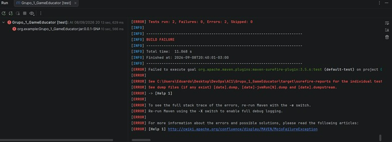 | 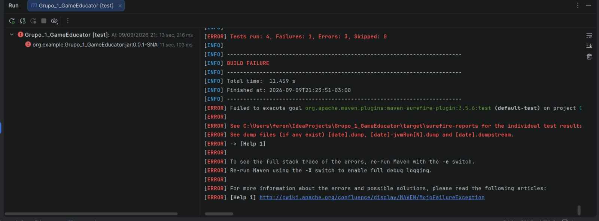 | 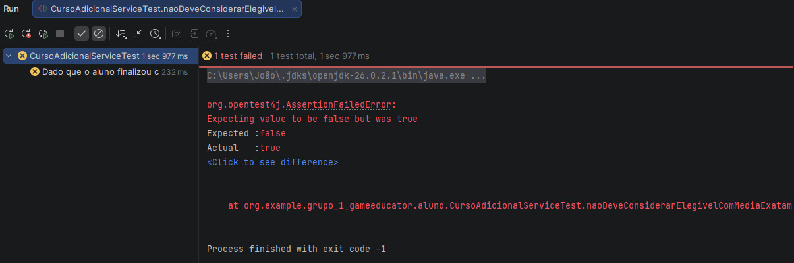 | 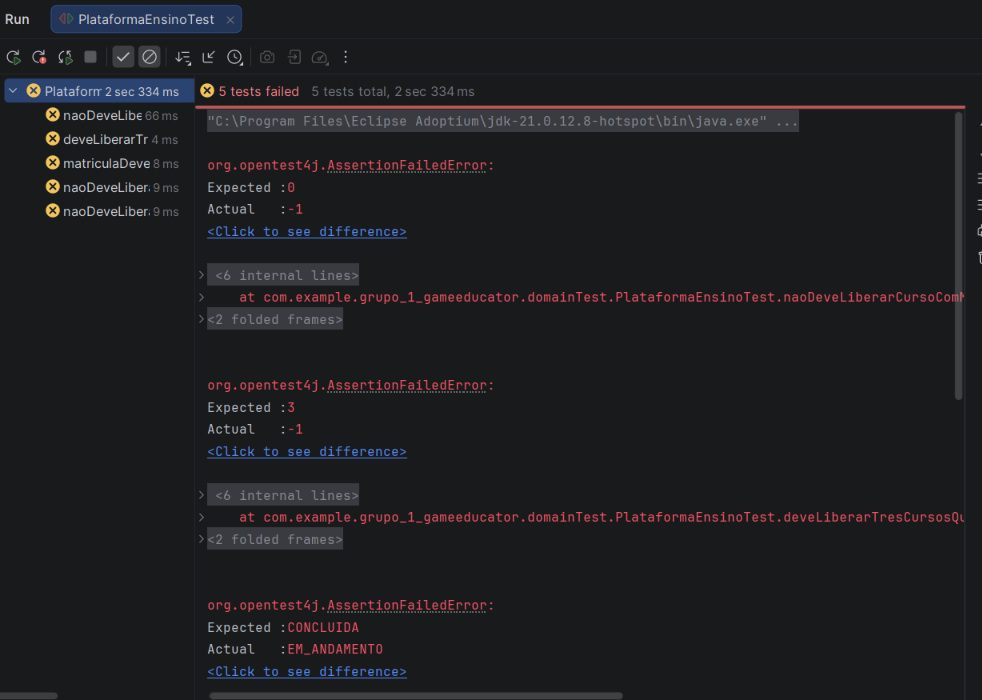 |

### GREEN — implementação mínima, todos os testes passando

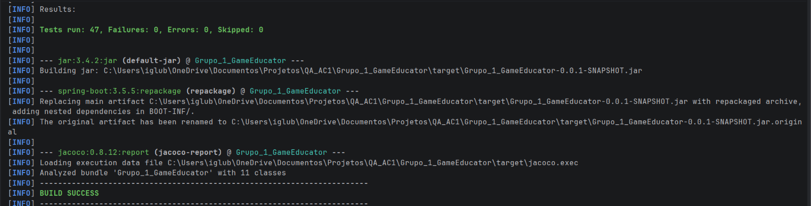

### BLUE — refatorado, todos os testes passando, 100% de cobertura no domínio sem vermelho/amarelo


| Relatório JaCoCo — parte 1 | Relatório JaCoCo — parte 2 |
|---|---|
| 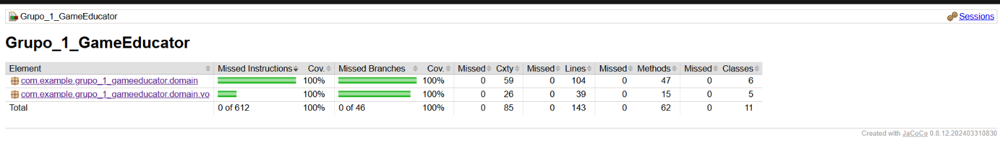 | 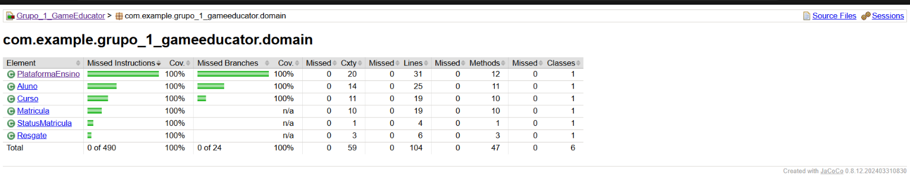 |

> As fotos antigas em `docs/evidencias/fotos-luiza/` são da primeira rodada, anterior à extração dos Value Objects — não refletem mais o código atual. Pode apagar essa pasta.

## Arquitetura

```
domain/          regras de negócio (TDD), também é a camada JPA (@Entity)
domain/vo/       Value Objects (@Embeddable): NomeAluno, EmailAluno, TituloCurso, DescricaoCurso, AreaCurso
repository/      Spring Data JPA
service/         orquestração, chama as regras do domain
dto/             entrada/saída da API
controller/      REST controllers + Swagger
```

## Exercício B1 — Architecture Lab

### Desafio 1 — Drivers e evolução do Core

*Decidir a arquitetura macro antes de decompor o sistema.*

**Cenário / problema:** o MVP cresceu de 1.000 para um cenário de até 100.000 usuários. O ranking cresce mais que outras funcionalidades, enquanto cursos, conquistas e recompensas continuam evoluindo. A equipe precisa decidir se mantém o Monólito em Camadas, evolui para Monólito Modular ou separa capacidades em serviços.

#### 1. RF — o que o sistema precisa fazer

| ID | Requisito | Descrição |
|---|---|---|
| RF01 | Ranking | Classificar e exibir os alunos por desempenho. |
| RF02 | Conquistas | Ao concluir um curso com média acima de 7,0, o aluno ganha direito a +3 cursos adicionais e pode resgatá-los entre até 10 cursos da mesma área. |

#### 2. RNF — qualidades a analisar

| ID | Qualidade | FURPS+ | Descrição |
|---|---|---|---|
| RNF01 | Escalabilidade | Supportability | Suportar o crescimento de 1.000 para 100.000 usuários, sendo o ranking a parte que cresce mais. |
| RNF02 | Desempenho | Performance | Consultas de ranking com tempo de resposta aceitável mesmo com volume alto de leituras. |
| RNF03 | Complexidade operacional | + (Operação) | Custo de implantar, monitorar e manter a solução com uma equipe de 6 devs. |
| RNF04 | Manutenibilidade | Supportability | Alterar uma regra de gamificação sem mexer em várias classes. |

#### 3. ASR — seleção obrigatória

| ASR | RNF de origem | Como altera a arquitetura |
|---|---|---|
| ASR01 | RNF04 — Manutenibilidade | Exige fronteiras explícitas por funcionalidade, o que muda a estrutura do Core. |
| ASR02 | RNF01 — Escalabilidade (ranking) | O ranking pode exigir cache, modelo de leitura ou escala própria, o que muda dados e implantação. |
| ASR03 | RNF03 — Complexidade operacional | Cada serviço separado adiciona deploy, rede e monitoramento, o que muda a operação. |

#### 4. RPC — restrições e premissas do desafio

| ID | Tipo | Restrição / premissa |
|---|---|---|
| RPC01 | Tecnologia (legado) | O Core já existe em Java 21/Spring Boot 3.5 (JPA) e deve continuar nessa stack; alternativas que exijam reescrevê-lo em outra tecnologia ficam fora. |
| RPC02 | Equipe (premissa do case) | O case considera uma equipe de 6 desenvolvedores, que também cuidam de implantação e operação. Isso limita quantos deploys, pipelines e serviços dá para manter. |
| RPC03 | Dados / infraestrutura | Há um único banco relacional (PostgreSQL 16 no `docker-compose`; H2 no perfil local) compartilhado por alunos, cursos e matrículas. Separar serviços exigiria dividir o banco ou aceitar banco compartilhado entre serviços. |
| RPC04 | Legado da AC1 | As regras de gamificação foram construídas por TDD no pacote `domain` (`PlataformaEnsino`, `Aluno`, `Matricula`), com testes; devem ser reaproveitadas, não reescritas. |
| P01 | Premissa | O crescimento até 100.000 usuários é uma projeção. O ranking (RF01) ainda não está implementado no repositório da AC1, então não há medição de gargalo real. |

#### 5. Decisão do Tech Lead

**Quais RNFs tornam-se ASRs neste cenário?**
Manutenibilidade (RNF04), escalabilidade do ranking (RNF01) e complexidade operacional (RNF03). O desempenho (RNF02) depende da escalabilidade do ranking e é tratado junto com ela.

**Há necessidade comprovada de escala/deploy independente?**
Não. O ranking é a funcionalidade que mais cresce, mas o problema dele é volume de leitura, que se resolve dentro do monólito com cache ou com uma tabela/visão pré-calculada de ranking, sem separar o deploy. Nenhuma funcionalidade tem ciclo de entrega ou stack diferente do restante do Core (a IA em Python só entra no Desafio 3).

**A complexidade distribuída é justificável?**
Não neste momento. Com 6 devs e um banco único (RPC02 e RPC03), cada serviço novo traria pipeline, rede, monitoramento e consistência entre bancos sem resolver um problema medido. O problema real encontrado no código é de organização interna: na AC1, a regra "média > 7,0 libera +3 cursos" está duplicada — existe em `PlataformaEnsino` (testada) e foi reimplementada em `MatriculaService` (que é o que a API executa). Ou seja, os testes de domínio não protegem o fluxo real, e alterar a regra exige mexer em mais de uma classe.

**Decisão:** evoluir para **Monólito Modular**, com módulos por capacidade (Alunos, Cursos, Matrículas, Conquistas e Ranking) e fronteiras explícitas: cada módulo expõe uma interface pública e mantém a implementação interna. O ranking ganha um modelo de leitura próprio (cache/tabela de ranking) dentro do monólito. A extração para serviço fica condicionada a gatilhos medidos (ver ADR-001).

#### 6. Alternativas e trade-offs

| Critério | (A) Monólito em Camadas | (B) Monólito Modular | (C) Decomposição seletiva (Ranking como serviço) |
|---|---|---|---|
| ASR01 — Manutenibilidade | Fraca: pacotes por tipo técnico (controller/service/repository) e regra espalhada entre classes | Forte: cada regra fica dentro do seu módulo, atrás de uma interface | Forte no serviço extraído; o restante continua com o mesmo problema |
| ASR02 — Escalabilidade do ranking | Escala o app inteiro; cache possível, mas sem fronteira clara | Escala o app inteiro; cache/modelo de leitura isolado no módulo Ranking | Escala o ranking de forma independente (melhor neste critério) |
| ASR03 — Complexidade operacional | Baixa: 1 deploy, 1 banco | Baixa: 1 deploy, 1 banco | Alta: +1 deploy, rede, monitoramento distribuído, consistência entre Core e Ranking |
| Aderência às RPCs | Atende | Atende e reaproveita o domínio da AC1 | Conflita com RPC02 (equipe) e RPC03 (banco único) |
| Custo de migração | Zero | Baixo/médio: reorganização de pacotes | Alto |

> **Trade-off aceito:** com a opção B, abrimos mão da escala independente do ranking em troca de simplicidade operacional e de regras de domínio bem localizadas. Como os módulos já terão fronteira definida, uma extração futura do Ranking (opção C) fica mais barata.

#### 7. Mini-lab / evidência

**Hipótese testada:** organizar a funcionalidade de Conquistas como um módulo com fronteira explícita reduz o acoplamento da regra de gamificação ao fluxo de matrícula, sem precisar separar serviços.

##### 7.1 Diagnóstico do estado atual (medido na branch `main`)

Contamos os imports entre pacotes de `src/main/java` na branch `main` do repositório (commit `6140a28`):

- O Core está organizado por camada técnica (`controller`, `service`, `repository`, `domain`, `dto`): **37 dependências entre pacotes**.
- O `MatriculaService` tem **10 dependências** e **6 referências à regra de gamificação** (média mínima, +3 cursos, limite de 10 opções).
- Os métodos `PlataformaEnsino.finalizarCurso` e `PlataformaEnsino.iniciarResgate`, cobertos pelos testes de `domainTest`, não são chamados pela API: o `MatriculaService` reimplementa a mesma regra. Por isso, alterar a regra exige mexer em 2 classes, e os testes de domínio não protegem o fluxo real.

##### 7.2 Reorganização modular (protótipo)

Montamos um protótipo da reorganização numa branch de trabalho (`desafio1-modulo-conquistas`):

- Criação do pacote `conquistas` com uma interface pública (`ConquistasApi`) e uma implementação package-private (`ConquistasService`), que delega para o domínio já testado (`PlataformaEnsino`).
- O `MatriculaService` passa a depender apenas de `ConquistasApi`.
- Um teste de arquitetura (`FronteiraConquistasTest`) verifica que a implementação do módulo não é pública.

**Resultado — `main` (atual) × protótipo:**

| Métrica | `main` (atual) | Protótipo modular |
|---|---|---|
| Referências à regra de gamificação fora do domínio/módulo (`MatriculaService`) | 6 | 0 |
| Dependências do `MatriculaService` | 10 | 9 |
| `MatriculaService` depende de `PlataformaEnsino` e `StatusMatricula` | Sim | Não (só de `ConquistasApi`) |
| A API executa a regra coberta pelos testes de domínio? | Não (regra duplicada) | Sim |
| Classes que precisam mudar para alterar a regra de +3 cursos | 2 (`PlataformaEnsino` e `MatriculaService`) | 1 (`PlataformaEnsino`, dentro do módulo) |
| Total de dependências entre pacotes | 37 | 44 |

**Leitura:** o número total de dependências sobe (37 → 44), porque o módulo novo adiciona uma interface e uma implementação. O ganho não está na quantidade, e sim na direção e na concentração: a regra deixa de estar duplicada, o fluxo de matrícula depende só do contrato do módulo e alterar a regra afeta um único lugar. Isso sustenta o ASR01 sem custo operacional novo (ASR03).

**Status da evidência no Git:** a medição da `main` é reproduzível no repositório atual. O protótipo modular, o teste de fronteira e o script de medição devem ser versionados na branch `desafio1-modulo-conquistas` e em `/docs/arquitetura/evidencias/desafio1/`, com a execução de `mvn test` registrada.

#### 8. ADR + C4

##### ADR-001 — Evolução do Core para Monólito Modular

| Campo | Conteúdo |
|---|---|
| Status | Aceito |
| Contexto | O produto vai de 1.000 para até 100.000 usuários, e o ranking (ainda não implementado) é a parte que mais cresce. As regras de gamificação mudam com frequência. Na AC1, o Core é um monólito em camadas técnicas e a regra de cursos adicionais está duplicada entre `PlataformaEnsino` e `MatriculaService`. |
| ASRs | ASR01 Manutenibilidade · ASR02 Escalabilidade do ranking · ASR03 Complexidade operacional |
| RPCs | Core em Java 21/Spring Boot · equipe de 6 devs (premissa do case) · banco relacional único · reaproveitar o domínio da AC1 |
| Alternativas | (A) Monólito em Camadas · (B) Monólito Modular · (C) Decomposição seletiva do Ranking em serviço |
| Decisão | Adotar (B): módulos por capacidade (Alunos, Cursos, Matrículas, Conquistas e Ranking) que se comunicam apenas por interfaces públicas, com 1 deploy e 1 banco. O ranking terá modelo de leitura/cache próprio dentro do módulo. |
| Consequências positivas | Regras em um único lugar; testes de domínio passam a proteger o fluxo real; operação continua simples; extração futura mais barata. |
| Consequências negativas / trade-offs | O ranking não escala separado do restante; a disciplina de fronteiras precisa ser garantida por convenção e teste (o compilador não impede tudo); o banco continua compartilhado entre módulos. |
| Gatilhos para revisitar (rumo à opção C) | Ranking com tempo de resposta fora da meta mesmo com cache; necessidade de deploy do ranking em ritmo diferente do Core; carga do ranking exigindo recursos que encarecem a escala do monólito inteiro. |

##### C4 — Container (nível afetado)

A decisão é interna ao Core: a implantação continua com um container de aplicação (`gameeducator-api`) e um banco PostgreSQL, como no `docker-compose` atual. O front web que roda hoje é HTML/CSS/JS estático em `src/main/resources/static`, servido pelo próprio Core. O arquivo `frontend-vue/index.html` é um cliente Vue avulso que chama `localhost:8080` e não faz parte do `docker-compose`. O pgAdmin do `docker-compose` é ferramenta de apoio e não aparece no diagrama.

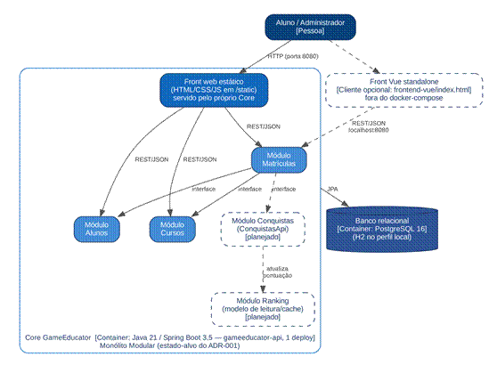

*Figura 1 — C4 Container do GameEducator: estado-alvo após o ADR-001. Elementos tracejados são planejados.*

## Endpoints principais

| Método | Rota | Descrição |
|---|---|---|
| GET | `/api/alunos` | Lista alunos |
| GET | `/api/alunos/{id}` | Busca aluno por id |
| POST | `/api/alunos` | Cria aluno |
| GET | `/api/cursos` | Lista cursos |
| POST | `/api/cursos` | Cria curso |
| POST | `/api/matriculas` | Matricula aluno em curso |
| PUT | `/api/matriculas/{id}/concluir` | Conclui matrícula com média final |
| GET | `/api/matriculas/{id}/resgate` | Resgata cursos relacionados (cenário do Felipe) |
| GET | `/api/matriculas/aluno/{alunoId}` | Lista matrículas de um aluno |

Documentação interativa: `/swagger-ui/index.html`.

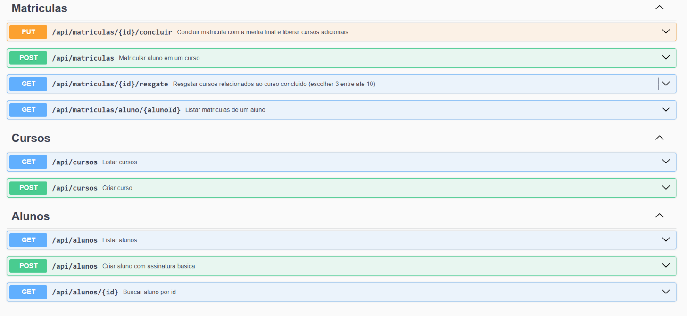

## Como rodar

### Local, com H2 (banco em memória)

```powershell
mvn spring-boot:run "-Dspring-boot.run.profiles=h2"
```

- Aplicação: http://localhost:8080
- Swagger: http://localhost:8080/swagger-ui/index.html
- Console H2: http://localhost:8080/h2-console (JDBC URL `jdbc:h2:mem:gameeducatordb`, usuário `sa`, senha em branco)

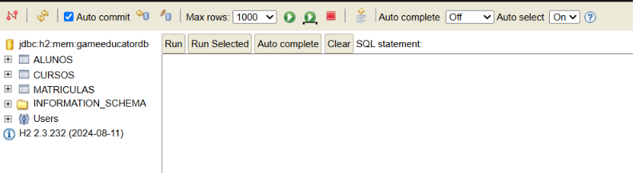

### Via Docker, com Postgres + pgAdmin

```powershell
docker compose down -v
docker compose up --build
```

- Aplicação: http://localhost:8080
- pgAdmin: http://localhost:5050 (login `admin@admin.com` / senha `admin`)
- Postgres (dentro da rede do compose): host `postgres`, porta `5432`, banco `gameeducator_db`, usuário/senha `postgres`

> Se a porta 5432 já estiver em uso por um Postgres local, altere o mapeamento de portas do serviço `postgres` no `docker-compose.yml` para `"5433:5432"` — a comunicação interna entre os containers continua em `5432`.

| Docker Desktop — containers rodando | pgAdmin — banco Postgres |
|---|---|
| 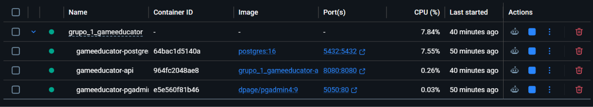 | 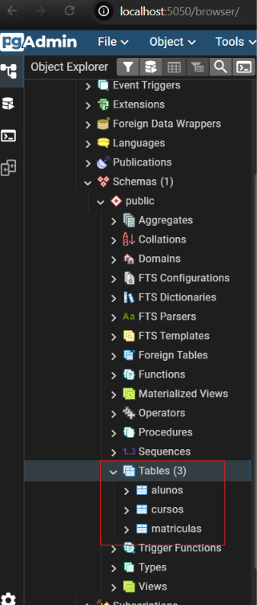 |

## Testes

```powershell
mvn clean verify
start target\site\jacoco\index.html
```

## Planilha

As User Stories e os BDDs completos do grupo também estão detalhados na planilha **"Grupo1 - US e BDD"**, enviada junto com este projeto no Canvas.
