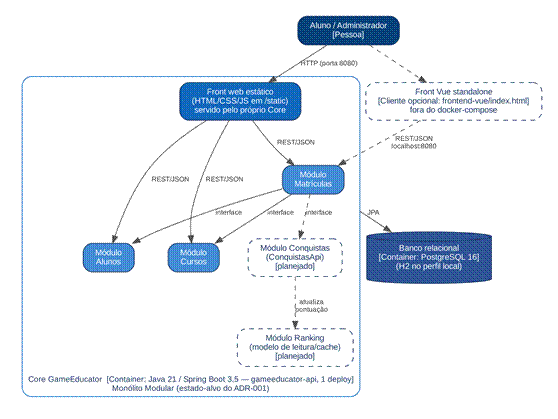

# Exercício B1 — Architecture Lab

Registro arquitetural cumulativo do GameEducator (Grupo 1). Cada desafio segue a cadeia RF → RNF → ASR + RPC → alternativas → ADR → C4 → evidência.

| Desafio | Decisão | ADR | Status |
|---|---|---|---|
| 1 — Drivers e evolução do Core | Monólito Modular | [ADR-001](#adr-001--evolução-do-core-para-monólito-modular) | Concluído |
| 2 — Organização interna do Core | — | — | A fazer |
| 3 — Serviço Python e IA | — | — | A fazer |
| 4 — Comunicação e eventos | — | — | A fazer |
| 5 — IoT e MQTT | — | — | A fazer |
| 6 — CI/CD e observabilidade | — | — | A fazer |

## Matriz cumulativa de ASRs

| ASR | Qualidade | Desafio 1 | Desafio 2 | Desafio 3 | Desafio 4 | Desafio 5 | Desafio 6 |
|---|---|---|---|---|---|---|---|
| ASR01 | Manutenibilidade | Dirige a decisão (módulos com fronteira) | | | | | |
| ASR02 | Escalabilidade do ranking | Dirige, ainda sem métrica (gatilho de extração) | | | | | |
| ASR03 | Complexidade operacional | Dirige a decisão (manter 1 deploy e 1 banco) | | | | | |

## Desafio 1 — Drivers e evolução do Core

*Decidir a arquitetura macro antes de decompor o sistema.*

**Cenário / problema:** o MVP cresceu de 1.000 para um cenário de até 100.000 usuários. O ranking cresce mais que outras funcionalidades, enquanto cursos, conquistas e recompensas continuam evoluindo. A equipe precisa decidir se mantém o Monólito em Camadas, evolui para Monólito Modular ou separa capacidades em serviços.

### 1. RF — o que o sistema precisa fazer

| ID | Requisito | Descrição |
|---|---|---|
| RF01 | Ranking | Classificar e exibir os alunos por desempenho. |
| RF02 | Conquistas | Ao concluir um curso com média acima de 7,0, o aluno ganha direito a +3 cursos adicionais e pode resgatá-los entre até 10 cursos da mesma área. |

### 2. RNF — qualidades a analisar

| ID | Qualidade | FURPS+ | Descrição |
|---|---|---|---|
| RNF01 | Escalabilidade | Supportability | Suportar o crescimento de 1.000 para 100.000 usuários, sendo o ranking a parte que cresce mais. |
| RNF02 | Desempenho | Performance | Consultas de ranking com tempo de resposta aceitável mesmo com volume alto de leituras. |
| RNF03 | Complexidade operacional | + (Operação) | Custo de implantar, monitorar e manter a solução com uma equipe de 6 devs. |
| RNF04 | Manutenibilidade | Supportability | Alterar uma regra de gamificação sem mexer em várias classes. |

### 3. ASR — seleção obrigatória

| ASR | RNF de origem | Como altera a arquitetura |
|---|---|---|
| ASR01 | RNF04 — Manutenibilidade | Exige fronteiras explícitas por funcionalidade, o que muda a estrutura do Core. |
| ASR02 | RNF01 — Escalabilidade (ranking) | O ranking pode exigir cache, modelo de leitura ou escala própria, o que muda dados e implantação. |
| ASR03 | RNF03 — Complexidade operacional | Cada serviço separado adiciona deploy, rede e monitoramento, o que muda a operação. |

### 4. RPC — restrições e premissas do desafio

| ID | Tipo | Restrição / premissa |
|---|---|---|
| RPC01 | Tecnologia (legado) | O Core já existe em Java 21/Spring Boot 3.5 (JPA) e deve continuar nessa stack; alternativas que exijam reescrevê-lo em outra tecnologia ficam fora. |
| RPC02 | Equipe (premissa do case) | O case considera uma equipe de 6 desenvolvedores, que também cuidam de implantação e operação. Isso limita quantos deploys, pipelines e serviços dá para manter. |
| RPC03 | Dados / infraestrutura | Há um único banco relacional (PostgreSQL 16 no `docker-compose`; H2 no perfil local) compartilhado por alunos, cursos e matrículas. Separar serviços exigiria dividir o banco ou aceitar banco compartilhado entre serviços. |
| RPC04 | Legado da AC1 | As regras de gamificação foram construídas por TDD no pacote `domain` (`PlataformaEnsino`, `Aluno`, `Matricula`), com testes; devem ser reaproveitadas, não reescritas. |
| P01 | Premissa | O crescimento até 100.000 usuários é uma projeção. O ranking (RF01) ainda não está implementado no repositório da AC1, então não há medição de gargalo real. |

### 5. Decisão do Tech Lead

**Quais RNFs tornam-se ASRs neste cenário?**
Manutenibilidade (RNF04), escalabilidade do ranking (RNF01) e complexidade operacional (RNF03). O desempenho (RNF02) depende da escalabilidade do ranking e é tratado junto com ela.

**Há necessidade comprovada de escala/deploy independente?**
Não. O ranking é a funcionalidade que mais cresce, mas o problema dele é volume de leitura, que se resolve dentro do monólito com cache ou com uma tabela/visão pré-calculada de ranking, sem separar o deploy. Nenhuma funcionalidade tem ciclo de entrega ou stack diferente do restante do Core (a IA em Python só entra no Desafio 3).

**A complexidade distribuída é justificável?**
Não neste momento. Com 6 devs e um banco único (RPC02 e RPC03), cada serviço novo traria pipeline, rede, monitoramento e consistência entre bancos sem resolver um problema medido. O problema real encontrado no código é de organização interna: na AC1, a regra "média > 7,0 libera +3 cursos" está duplicada — existe em `PlataformaEnsino` (testada) e foi reimplementada em `MatriculaService` (que é o que a API executa). Ou seja, os testes de domínio não protegem o fluxo real, e alterar a regra exige mexer em mais de uma classe.

**Decisão:** evoluir para **Monólito Modular**, com módulos por capacidade (Alunos, Cursos, Matrículas, Conquistas e Ranking) e fronteiras explícitas: cada módulo expõe uma interface pública e mantém a implementação interna. O ranking ganha um modelo de leitura próprio (cache/tabela de ranking) dentro do monólito. A extração para serviço fica condicionada a gatilhos medidos (ver ADR-001).

### 6. Alternativas e trade-offs

| Critério | (A) Monólito em Camadas | (B) Monólito Modular | (C) Decomposição seletiva (Ranking como serviço) |
|---|---|---|---|
| ASR01 — Manutenibilidade | Fraca: pacotes por tipo técnico (controller/service/repository) e regra espalhada entre classes | Forte: cada regra fica dentro do seu módulo, atrás de uma interface | Forte no serviço extraído; o restante continua com o mesmo problema |
| ASR02 — Escalabilidade do ranking | Escala o app inteiro; cache possível, mas sem fronteira clara | Escala o app inteiro; cache/modelo de leitura isolado no módulo Ranking | Escala o ranking de forma independente (melhor neste critério) |
| ASR03 — Complexidade operacional | Baixa: 1 deploy, 1 banco | Baixa: 1 deploy, 1 banco | Alta: +1 deploy, rede, monitoramento distribuído, consistência entre Core e Ranking |
| Aderência às RPCs | Atende | Atende e reaproveita o domínio da AC1 | Conflita com RPC02 (equipe) e RPC03 (banco único) |
| Custo de migração | Zero | Baixo/médio: reorganização de pacotes | Alto |

> **Trade-off aceito:** com a opção B, abrimos mão da escala independente do ranking em troca de simplicidade operacional e de regras de domínio bem localizadas. Como os módulos já terão fronteira definida, uma extração futura do Ranking (opção C) fica mais barata.

### 7. Mini-lab / evidência

**Hipótese testada:** organizar a funcionalidade de Conquistas como um módulo com fronteira explícita reduz o acoplamento da regra de gamificação ao fluxo de matrícula, sem precisar separar serviços.

Tudo o que está nesta seção está versionado no repositório e pode ser reproduzido:

| Evidência | Onde está |
|---|---|
| Módulo Conquistas | [`src/main/java/.../conquistas/`](../../src/main/java/com/example/grupo_1_gameeducator/conquistas) — `ConquistasApi` (pública) e `ConquistasService` (package-private) |
| Fluxo de matrícula refatorado | [`MatriculaService`](../../src/main/java/com/example/grupo_1_gameeducator/service/MatriculaService.java) depende só de `ConquistasApi` |
| Teste de fronteira | [`FronteiraConquistasTest`](../../src/test/java/com/example/grupo_1_gameeducator/conquistas/FronteiraConquistasTest.java) |
| Testes do módulo (sem Spring/banco) | [`ConquistasServiceTest`](../../src/test/java/com/example/grupo_1_gameeducator/conquistas/ConquistasServiceTest.java) |
| Teste do fluxo real da API (Spring + H2) | [`ConquistasIntegracaoTest`](../../src/test/java/com/example/grupo_1_gameeducator/conquistas/ConquistasIntegracaoTest.java) |
| Script de medição + saídas antes/depois | [`evidencias/desafio1/`](evidencias/desafio1) |

#### 7.1 Diagnóstico do estado anterior (commit `cc06434`)

O Core estava organizado por camada técnica (`controller`, `service`, `repository`, `domain`, `dto`). Os métodos `PlataformaEnsino.finalizarCurso` e `PlataformaEnsino.iniciarResgate`, cobertos pelos testes de `domainTest`, não eram chamados pela API: o `MatriculaService` reimplementava a mesma regra (5 referências à média mínima, aos +3 cursos e ao limite de 10 opções). Alterar a regra exigia mexer em 2 classes, e os testes de domínio não protegiam o fluxo real.

#### 7.2 Reorganização modular

- Criado o pacote `conquistas` com a interface pública `ConquistasApi` e a implementação package-private `ConquistasService`, que **delega para o domínio já testado** (`PlataformaEnsino.finalizarCurso` e `PlataformaEnsino.iniciarResgate`). Nenhuma regra foi reescrita (RPC04).
- O `MatriculaService` passou a receber `ConquistasApi` no construtor e não usa mais `PlataformaEnsino` nem `StatusMatricula`.
- O comportamento da API foi mantido: mesmas rotas, mesmos DTOs e mesmas mensagens de erro.

#### 7.3 Resultado — antes × depois

Medido com `python docs/arquitetura/evidencias/desafio1/medir_dependencias.py` ([antes](evidencias/desafio1/dependencias-antes.txt) · [depois](evidencias/desafio1/dependencias-depois.txt)):

| Métrica | Antes (`cc06434`) | Depois (módulo Conquistas) |
|---|---|---|
| Referências à regra de gamificação no `MatriculaService` | 5 | 0 |
| `MatriculaService` depende de `PlataformaEnsino` e `StatusMatricula` | Sim | Não (só de `ConquistasApi`) |
| A API executa a regra coberta pelos testes de domínio? | Não (regra duplicada) | Sim (comprovado por `ConquistasIntegracaoTest`) |
| Classes a alterar para mudar a regra de +3 cursos | 2 (`PlataformaEnsino` e `MatriculaService`) | 1 (`PlataformaEnsino`, atrás do módulo) |
| Imports do projeto no `MatriculaService` | 10 | 10 |
| Imports entre classes de pacotes diferentes (total) | 37 | 45 |
| Dependências entre pacotes (pares distintos) | 7 | 10 |

**Leitura:** o total de dependências sobe (37 → 45 imports; 7 → 10 pares de pacotes), porque o módulo novo é mais um pacote, com interface e implementação. O ganho não está na quantidade, e sim na direção e na concentração: a regra deixou de estar duplicada, o fluxo de matrícula depende só do contrato do módulo e alterar a regra afeta um único lugar. Isso sustenta o ASR01 (manutenibilidade) sem custo operacional novo (ASR03): continua 1 deploy e 1 banco.

**O que ainda não foi comprovado:** a escalabilidade do ranking (ASR02). O ranking não existe no código da AC1, então não há métrica de carga; a extração continua condicionada aos gatilhos do ADR-001.

#### 7.4 Execução dos testes

`./mvnw test` na raiz do projeto. Print da execução: [`evidencias/desafio1/mvn-test.png`](evidencias/desafio1/mvn-test.png).

### 8. ADR + C4

#### ADR-001 — Evolução do Core para Monólito Modular

| Campo | Conteúdo |
|---|---|
| Status | Aceito |
| Contexto | O produto vai de 1.000 para até 100.000 usuários, e o ranking (ainda não implementado) é a parte que mais cresce. As regras de gamificação mudam com frequência. Na AC1, o Core é um monólito em camadas técnicas e a regra de cursos adicionais está duplicada entre `PlataformaEnsino` e `MatriculaService`. |
| ASRs | ASR01 Manutenibilidade · ASR02 Escalabilidade do ranking · ASR03 Complexidade operacional |
| RPCs | Core em Java 21/Spring Boot · equipe de 6 devs (premissa do case) · banco relacional único · reaproveitar o domínio da AC1 |
| Alternativas | (A) Monólito em Camadas · (B) Monólito Modular · (C) Decomposição seletiva do Ranking em serviço |
| Decisão | Adotar (B): módulos por capacidade (Alunos, Cursos, Matrículas, Conquistas e Ranking) que se comunicam apenas por interfaces públicas, com 1 deploy e 1 banco. O ranking terá modelo de leitura/cache próprio dentro do módulo. |
| Consequências positivas | Regras em um único lugar; testes de domínio passam a proteger o fluxo real; operação continua simples; extração futura mais barata. |
| Consequências negativas / trade-offs | O ranking não escala separado do restante; a disciplina de fronteiras precisa ser garantida por convenção e teste (o compilador não impede tudo); o banco continua compartilhado entre módulos. |
| Gatilhos para revisitar (rumo à opção C) | Ranking com tempo de resposta fora da meta mesmo com cache; necessidade de deploy do ranking em ritmo diferente do Core; carga do ranking exigindo recursos que encarecem a escala do monólito inteiro. |

#### C4 — Container (nível afetado)

A decisão é interna ao Core: a implantação continua com um container de aplicação (`gameeducator-api`) e um banco PostgreSQL, como no `docker-compose` atual. O front web que roda hoje é HTML/CSS/JS estático em `src/main/resources/static`, servido pelo próprio Core. O arquivo `frontend-vue/index.html` é um cliente Vue avulso que chama `localhost:8080` e não faz parte do `docker-compose`. O pgAdmin do `docker-compose` é ferramenta de apoio e não aparece no diagrama.

*Figura 1 — C4 Container do GameEducator: estado-alvo após o ADR-001. Elementos tracejados são planejados.*

