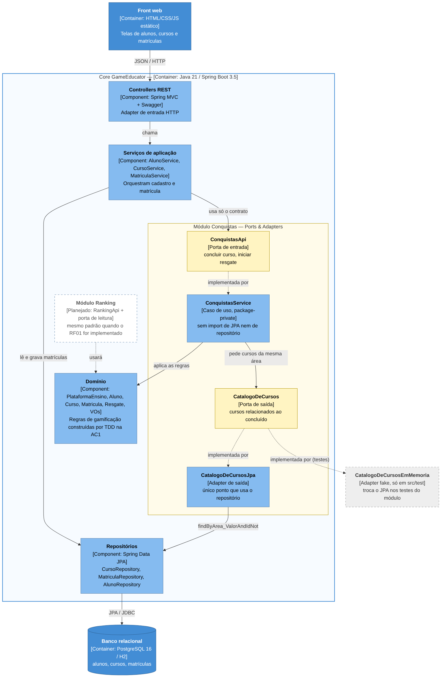

# Exercício B1 — Architecture Lab

Registro arquitetural cumulativo do GameEducator (Grupo 1). Cada desafio segue a cadeia RF → RNF → ASR + RPC → alternativas → ADR → C4 → evidência.

| Desafio | Decisão | ADR | Status |
|---|---|---|---|
| 1 — Drivers e evolução do Core | Monólito Modular | [ADR-001](#adr-001--evolução-do-core-para-monólito-modular) | Concluído |
| 2 — Organização interna do Core | Ports & Adapters seletivo | [ADR-002](#adr-002--ports--adapters-seletivo-nos-módulos-de-gamificação) | Concluído |
| 3 — Serviço Python e IA | — | — | A fazer |
| 4 — Comunicação e eventos | — | — | A fazer |
| 5 — IoT e MQTT | — | — | A fazer |
| 6 — CI/CD e observabilidade | — | — | A fazer |

## Matriz cumulativa de ASRs

| ASR | Qualidade | Desafio 1 | Desafio 2 | Desafio 3 | Desafio 4 | Desafio 5 | Desafio 6 |
|---|---|---|---|---|---|---|---|
| ASR01 | Manutenibilidade | Dirige a decisão (módulos com fronteira) | Dirige (fronteira passa a isolar a regra também da infraestrutura) | | | | |
| ASR02 | Escalabilidade do ranking | Dirige, ainda sem métrica (gatilho de extração) | Não pesa (decisão interna, sem efeito em carga) | | | | |
| ASR03 | Complexidade operacional | Dirige a decisão (manter 1 deploy e 1 banco) | Não pesa (sem novo deploy nem componente) | | | | |
| ASR04 | Testabilidade | — | Dirige (caso de uso testável sem Spring, banco ou mock) | | | | |
| ASR05 | Modificabilidade | — | Dirige (trocar a tecnologia de dados só no adapter) | | | | |

## Desafio 1 — Drivers e evolução do Core

*Decidir a arquitetura macro antes de decompor o sistema.*

**Cenário / problema:** o MVP cresceu de 1.000 para um cenário de até 100.000 usuários. O ranking cresce mais que outras funcionalidades, enquanto cursos, conquistas e recompensas continuam evoluindo. A equipe precisa decidir se mantém o Monólito em Camadas, evolui para Monólito Modular ou separa capacidades em serviços.

### 1. RF — o que o sistema precisa fazer

| ID | Requisito | Descrição |
|---|---|---|
| RF01 | Ranking | Classificar e exibir os alunos por desempenho. |
| RF02 | Conquistas | Ao concluir um curso com média acima de 7,0, o aluno ganha direito a +3 cursos adicionais e pode resgatá-los entre até 10 cursos da mesma área. |

### 2. RNF — qualidades a analisar

| ID | Qualidade | FURPS+ | Descrição |
|---|---|---|---|
| RNF01 | Escalabilidade | Supportability | Suportar o crescimento de 1.000 para 100.000 usuários, sendo o ranking a parte que cresce mais. |
| RNF02 | Desempenho | Performance | Consultas de ranking com tempo de resposta aceitável mesmo com volume alto de leituras. |
| RNF03 | Complexidade operacional | + (Operação) | Custo de implantar, monitorar e manter a solução com uma equipe de 6 devs. |
| RNF04 | Manutenibilidade | Supportability | Alterar uma regra de gamificação sem mexer em várias classes. |

### 3. ASR — seleção obrigatória

| ASR | RNF de origem | Como altera a arquitetura |
|---|---|---|
| ASR01 | RNF04 — Manutenibilidade | Exige fronteiras explícitas por funcionalidade, o que muda a estrutura do Core. |
| ASR02 | RNF01 — Escalabilidade (ranking) | O ranking pode exigir cache, modelo de leitura ou escala própria, o que muda dados e implantação. |
| ASR03 | RNF03 — Complexidade operacional | Cada serviço separado adiciona deploy, rede e monitoramento, o que muda a operação. |

### 4. RPC — restrições e premissas do desafio

| ID | Tipo | Restrição / premissa |
|---|---|---|
| RPC01 | Tecnologia (legado) | O Core já existe em Java 21/Spring Boot 3.5 (JPA) e deve continuar nessa stack; alternativas que exijam reescrevê-lo em outra tecnologia ficam fora. |
| RPC02 | Equipe (premissa do case) | O case considera uma equipe de 6 desenvolvedores, que também cuidam de implantação e operação. Isso limita quantos deploys, pipelines e serviços dá para manter. |
| RPC03 | Dados / infraestrutura | Há um único banco relacional (PostgreSQL 16 no `docker-compose`; H2 no perfil local) compartilhado por alunos, cursos e matrículas. Separar serviços exigiria dividir o banco ou aceitar banco compartilhado entre serviços. |
| RPC04 | Legado da AC1 | As regras de gamificação foram construídas por TDD no pacote `domain` (`PlataformaEnsino`, `Aluno`, `Matricula`), com testes; devem ser reaproveitadas, não reescritas. |
| P01 | Premissa | O crescimento até 100.000 usuários é uma projeção. O ranking (RF01) ainda não está implementado no repositório da AC1, então não há medição de gargalo real. |

### 5. Decisão do Tech Lead

**Quais RNFs tornam-se ASRs neste cenário?**
Manutenibilidade (RNF04), escalabilidade do ranking (RNF01) e complexidade operacional (RNF03). O desempenho (RNF02) depende da escalabilidade do ranking e é tratado junto com ela.

**Há necessidade comprovada de escala/deploy independente?**
Não. O ranking é a funcionalidade que mais cresce, mas o problema dele é volume de leitura, que se resolve dentro do monólito com cache ou com uma tabela/visão pré-calculada de ranking, sem separar o deploy. Nenhuma funcionalidade tem ciclo de entrega ou stack diferente do restante do Core (a IA em Python só entra no Desafio 3).

**A complexidade distribuída é justificável?**
Não neste momento. Com 6 devs e um banco único (RPC02 e RPC03), cada serviço novo traria pipeline, rede, monitoramento e consistência entre bancos sem resolver um problema medido. O problema real encontrado no código é de organização interna: na AC1, a regra "média > 7,0 libera +3 cursos" está duplicada — existe em `PlataformaEnsino` (testada) e foi reimplementada em `MatriculaService` (que é o que a API executa). Ou seja, os testes de domínio não protegem o fluxo real, e alterar a regra exige mexer em mais de uma classe.

**Decisão:** evoluir para **Monólito Modular**, com módulos por capacidade (Alunos, Cursos, Matrículas, Conquistas e Ranking) e fronteiras explícitas: cada módulo expõe uma interface pública e mantém a implementação interna. O ranking ganha um modelo de leitura próprio (cache/tabela de ranking) dentro do monólito. A extração para serviço fica condicionada a gatilhos medidos (ver ADR-001).

### 6. Alternativas e trade-offs

| Critério | (A) Monólito em Camadas | (B) Monólito Modular | (C) Decomposição seletiva (Ranking como serviço) |
|---|---|---|---|
| ASR01 — Manutenibilidade | Fraca: pacotes por tipo técnico (controller/service/repository) e regra espalhada entre classes | Forte: cada regra fica dentro do seu módulo, atrás de uma interface | Forte no serviço extraído; o restante continua com o mesmo problema |
| ASR02 — Escalabilidade do ranking | Escala o app inteiro; cache possível, mas sem fronteira clara | Escala o app inteiro; cache/modelo de leitura isolado no módulo Ranking | Escala o ranking de forma independente (melhor neste critério) |
| ASR03 — Complexidade operacional | Baixa: 1 deploy, 1 banco | Baixa: 1 deploy, 1 banco | Alta: +1 deploy, rede, monitoramento distribuído, consistência entre Core e Ranking |
| Aderência às RPCs | Atende | Atende e reaproveita o domínio da AC1 | Conflita com RPC02 (equipe) e RPC03 (banco único) |
| Custo de migração | Zero | Baixo/médio: reorganização de pacotes | Alto |

> **Trade-off aceito:** com a opção B, abrimos mão da escala independente do ranking em troca de simplicidade operacional e de regras de domínio bem localizadas. Como os módulos já terão fronteira definida, uma extração futura do Ranking (opção C) fica mais barata.

### 7. Mini-lab / evidência

**Hipótese testada:** organizar a funcionalidade de Conquistas como um módulo com fronteira explícita reduz o acoplamento da regra de gamificação ao fluxo de matrícula, sem precisar separar serviços.

Tudo o que está nesta seção está versionado no repositório e pode ser reproduzido:

| Evidência | Onde está |
|---|---|
| Módulo Conquistas | [`src/main/java/.../conquistas/`](../../src/main/java/com/example/grupo_1_gameeducator/conquistas) — `ConquistasApi` (pública) e `ConquistasService` (package-private) |
| Fluxo de matrícula refatorado | [`MatriculaService`](../../src/main/java/com/example/grupo_1_gameeducator/service/MatriculaService.java) depende só de `ConquistasApi` |
| Teste de fronteira | [`FronteiraConquistasTest`](../../src/test/java/com/example/grupo_1_gameeducator/conquistas/FronteiraConquistasTest.java) |
| Testes do módulo (sem Spring/banco) | [`ConquistasServiceTest`](../../src/test/java/com/example/grupo_1_gameeducator/conquistas/ConquistasServiceTest.java) |
| Teste do fluxo real da API (Spring + H2) | [`ConquistasIntegracaoTest`](../../src/test/java/com/example/grupo_1_gameeducator/conquistas/ConquistasIntegracaoTest.java) |
| Script de medição + saídas antes/depois | [`evidencias/desafio1/`](evidencias/desafio1) |

#### 7.1 Diagnóstico do estado anterior (commit `cc06434`)

O Core estava organizado por camada técnica (`controller`, `service`, `repository`, `domain`, `dto`). Os métodos `PlataformaEnsino.finalizarCurso` e `PlataformaEnsino.iniciarResgate`, cobertos pelos testes de `domainTest`, não eram chamados pela API: o `MatriculaService` reimplementava a mesma regra (5 referências à média mínima, aos +3 cursos e ao limite de 10 opções). Alterar a regra exigia mexer em 2 classes, e os testes de domínio não protegiam o fluxo real.

#### 7.2 Reorganização modular

- Criado o pacote `conquistas` com a interface pública `ConquistasApi` e a implementação package-private `ConquistasService`, que **delega para o domínio já testado** (`PlataformaEnsino.finalizarCurso` e `PlataformaEnsino.iniciarResgate`). Nenhuma regra foi reescrita (RPC04).
- O `MatriculaService` passou a receber `ConquistasApi` no construtor e não usa mais `PlataformaEnsino` nem `StatusMatricula`.
- O comportamento da API foi mantido: mesmas rotas, mesmos DTOs e mesmas mensagens de erro.

#### 7.3 Resultado — antes × depois

Medido com `python docs/arquitetura/evidencias/desafio1/medir_dependencias.py` ([antes](evidencias/desafio1/dependencias-antes.txt) · [depois](evidencias/desafio1/dependencias-depois.txt)):

| Métrica | Antes (`cc06434`) | Depois (módulo Conquistas) |
|---|---|---|
| Referências à regra de gamificação no `MatriculaService` | 5 | 0 |
| `MatriculaService` depende de `PlataformaEnsino` e `StatusMatricula` | Sim | Não (só de `ConquistasApi`) |
| A API executa a regra coberta pelos testes de domínio? | Não (regra duplicada) | Sim (comprovado por `ConquistasIntegracaoTest`) |
| Classes a alterar para mudar a regra de +3 cursos | 2 (`PlataformaEnsino` e `MatriculaService`) | 1 (`PlataformaEnsino`, atrás do módulo) |
| Imports do projeto no `MatriculaService` | 10 | 10 |
| Imports entre classes de pacotes diferentes (total) | 37 | 45 |
| Dependências entre pacotes (pares distintos) | 7 | 10 |

**Leitura:** o total de dependências sobe (37 → 45 imports; 7 → 10 pares de pacotes), porque o módulo novo é mais um pacote, com interface e implementação. O ganho não está na quantidade, e sim na direção e na concentração: a regra deixou de estar duplicada, o fluxo de matrícula depende só do contrato do módulo e alterar a regra afeta um único lugar. Isso sustenta o ASR01 (manutenibilidade) sem custo operacional novo (ASR03): continua 1 deploy e 1 banco.

**O que ainda não foi comprovado:** a escalabilidade do ranking (ASR02). O ranking não existe no código da AC1, então não há métrica de carga; a extração continua condicionada aos gatilhos do ADR-001.

#### 7.4 Execução dos testes

`./mvnw test` na raiz do projeto. Print da execução: [`evidencias/desafio1/mvn-test.png`](evidencias/desafio1/mvn-test.png).

### 8. ADR + C4

#### ADR-001 — Evolução do Core para Monólito Modular

| Campo | Conteúdo |
|---|---|
| Status | Aceito |
| Contexto | O produto vai de 1.000 para até 100.000 usuários, e o ranking (ainda não implementado) é a parte que mais cresce. As regras de gamificação mudam com frequência. Na AC1, o Core é um monólito em camadas técnicas e a regra de cursos adicionais está duplicada entre `PlataformaEnsino` e `MatriculaService`. |
| ASRs | ASR01 Manutenibilidade · ASR02 Escalabilidade do ranking · ASR03 Complexidade operacional |
| RPCs | Core em Java 21/Spring Boot · equipe de 6 devs (premissa do case) · banco relacional único · reaproveitar o domínio da AC1 |
| Alternativas | (A) Monólito em Camadas · (B) Monólito Modular · (C) Decomposição seletiva do Ranking em serviço |
| Decisão | Adotar (B): módulos por capacidade (Alunos, Cursos, Matrículas, Conquistas e Ranking) que se comunicam apenas por interfaces públicas, com 1 deploy e 1 banco. O ranking terá modelo de leitura/cache próprio dentro do módulo. |
| Consequências positivas | Regras em um único lugar; testes de domínio passam a proteger o fluxo real; operação continua simples; extração futura mais barata. |
| Consequências negativas / trade-offs | O ranking não escala separado do restante; a disciplina de fronteiras precisa ser garantida por convenção e teste (o compilador não impede tudo); o banco continua compartilhado entre módulos. |
| Gatilhos para revisitar (rumo à opção C) | Ranking com tempo de resposta fora da meta mesmo com cache; necessidade de deploy do ranking em ritmo diferente do Core; carga do ranking exigindo recursos que encarecem a escala do monólito inteiro. |

#### C4 — Container (nível afetado)

A decisão é interna ao Core: a implantação continua com um container de aplicação (`gameeducator-api`) e um banco PostgreSQL, como no `docker-compose` atual. O front web que roda hoje é HTML/CSS/JS estático em `src/main/resources/static`, servido pelo próprio Core. O arquivo `frontend-vue/index.html` é um cliente Vue avulso que chama `localhost:8080` e não faz parte do `docker-compose`. O pgAdmin do `docker-compose` é ferramenta de apoio e não aparece no diagrama.

*Figura 1 — C4 Container do GameEducator: estado-alvo após o ADR-001. Elementos tracejados são planejados.*

## Desafio 2 — Organização interna do Core

*Proteger o domínio contra dependências técnicas.*

**Cenário / problema:** as regras de ranking, moedas, badges e recompensas mudam com frequência. A equipe precisa evitar que domínio, banco, framework e integrações externas fiquem fortemente acoplados.

### 1. RF — o que o sistema precisa fazer

| ID | Requisito | Descrição |
|---|---|---|
| RF01 | Ranking | Classificar e exibir os alunos por desempenho (ainda não implementado; entra como módulo planejado). |
| RF02 | Conquistas e regras de gamificação | Média acima de 7,0 libera +3 cursos adicionais; o resgate oferece até 10 cursos da mesma área para o aluno escolher 3. |

### 2. RNF — qualidades a analisar

| ID | Qualidade | FURPS+ | Descrição |
|---|---|---|---|
| RNF04 | Manutenibilidade | Supportability | Alterar uma regra de gamificação mexendo em um só lugar (vem do Desafio 1). |
| RNF05 | Testabilidade | Supportability | Testar as regras e o caso de uso sem subir Spring, sem banco e sem mock de framework. |
| RNF06 | Modificabilidade | Supportability | Trocar a tecnologia que fornece os dados (JPA, memória, outro serviço) sem alterar a regra. |
| RNF07 | Facilidade de evolução | Supportability | Novas regras (moedas, badges, ranking) entram seguindo o mesmo padrão, sem reorganizar o Core. |

### 3. ASR — seleção obrigatória

| ASR | RNF de origem | ASR? | Como altera a arquitetura |
|---|---|---|---|
| ASR04 | RNF05 — Testabilidade | Sim | Exige que o caso de uso receba as dependências de infraestrutura por interfaces (portas), o que muda a estrutura interna do módulo. |
| ASR05 | RNF06 — Modificabilidade | Sim | Exige um ponto único (adapter) onde a tecnologia de dados é conectada, o que muda quem depende de quem dentro do Core. |
| ASR01 | RNF04 — Manutenibilidade | Sim (continua do D1) | A fronteira do módulo, criada no D1, passa a valer também para a infraestrutura: a regra fica isolada do banco. |
| — | RNF07 — Facilidade de evolução | Não, neste momento | É consequência das três acima; o ranking ainda não existe para medir esse ganho. |

### 4. RPC — restrições e premissas do desafio

| ID | Tipo | Restrição / premissa |
|---|---|---|
| RPC01 | Tecnologia (legado) | O Core continua em Java 21/Spring Boot 3.5 com Spring Data JPA (vem do D1). |
| RPC04 | Legado da AC1 | As regras de `PlataformaEnsino`, `Aluno` e `Matricula`, construídas por TDD, devem ser reaproveitadas, não reescritas (vem do D1). |
| RPC05 | Escopo | Não é permitido reescrever o produto inteiro só para aplicar um padrão: a mudança precisa ser proporcional ao problema. |
| RPC06 | Legado da AC1 | As classes de domínio também são as entidades JPA (`@Entity`, `@Embeddable`). Separar modelo de domínio e modelo de persistência exigiria reescrever todas elas e criar mapeadores. |
| P02 | Premissa | O ranking (RF01) ainda não está implementado; o padrão é validado no módulo Conquistas e replicado no Ranking quando ele for construído. |

### 5. Decisão do Tech Lead

**Qual dependência realmente precisa ser invertida?**
A do caso de uso de gamificação para o repositório JPA. Depois do Desafio 1, o `ConquistasService` recebia o `CursoRepository` (uma interface do Spring Data) no construtor. Por isso, o teste do módulo precisava de um mock do Mockito de uma interface do Spring Data, e trocar a origem dos cursos exigia mexer no caso de uso. Essa é a dependência que liga a regra à tecnologia.

As anotações JPA nas classes de domínio **não** foram invertidas: elas são metadados, não chamam o banco, e os testes de domínio já rodam sem JPA (`new Aluno(...)`, `new Curso(...)`). Separá-las custaria reescrever todas as entidades (RPC05 e RPC06) sem resolver um problema medido.

**O custo estrutural é proporcional ao problema?**
Sim, com a aplicação seletiva: 1 interface (porta de saída `CatalogoDeCursos`), 1 adapter de produção (`CatalogoDeCursosJpa`, 25 linhas) e 1 adapter de teste (`CatalogoDeCursosEmMemoria`, 27 linhas). Nenhuma regra foi reescrita, nenhuma rota mudou e o deploy continua igual. Aplicar Hexagonal completa em todo o Core (cadastro de aluno e de curso, que são CRUD sem regra de gamificação) não seria proporcional.

**DDD, Hexagonal, Clean e Onion são concorrentes ou podem ser combinados?**
Podem ser combinados, porque respondem a perguntas diferentes:

- **DDD (tático)** trata de *como modelar* o domínio. O projeto já usa entidades e Value Objects desde a AC1 (`NomeAluno`, `TituloCurso`, `AreaCurso`...); isso continua.
- **Hexagonal (Ports & Adapters)** trata de *como o domínio conversa com o mundo de fora*: portas de entrada e de saída, com adapters plugáveis. É o que resolve o problema deste desafio.
- **Clean e Onion** seguem a mesma regra de dependência da Hexagonal (as dependências apontam para o domínio), com mais camadas nomeadas (entidades, casos de uso, interface adapters, frameworks). Adotamos a regra de dependência, mas não as camadas extras: elas acrescentariam classes sem resolver nenhum problema do case.

**Decisão:** aplicar **Ports & Adapters (Hexagonal) de forma seletiva** dentro dos módulos de regra de gamificação do Monólito Modular (ADR-001). Cada módulo tem uma porta de entrada (a `*Api` pública do D1), um caso de uso interno e portas de saída para tudo o que for infraestrutura. Os adapters ficam em subpacotes `adapter.*`. O domínio da AC1 é mantido como está, incluindo as anotações JPA (trade-off registrado no ADR-002). A regra é protegida por teste de arquitetura.

### 6. Alternativas e trade-offs

| Critério | (A) Estrutura atual (módulo do D1 chamando o JPA) | (B) Ports & Adapters seletivo | (C) Hexagonal/Clean completa em todo o Core |
|---|---|---|---|
| ASR04 — Testabilidade | Média: o caso de uso só é testado com mock do repositório ou com Spring + H2 | Alta: o caso de uso roda com um adapter em memória, sem Spring, banco ou mock | Alta |
| ASR05 — Modificabilidade | Baixa: trocar a origem dos dados muda o caso de uso | Alta no módulo: trocar a origem só muda o adapter | Alta em todo o Core |
| ASR01 — Manutenibilidade | Regra isolada dos outros módulos (D1), mas presa ao JPA | Regra isolada dos outros módulos e da infraestrutura | Igual a (B), com muito mais classes para manter |
| RPC05 — Proporcionalidade | Nenhuma mudança | 3 classes novas, 1 alterada | Reescrever 3 entidades, 5 VOs, criar modelos de persistência e mapeadores |
| RPC04/RPC06 — Legado | Atende | Atende (domínio intacto) | Conflita: as entidades JPA da AC1 teriam de ser desmontadas |

> **Trade-off aceito:** com a opção B, o domínio continua anotado com JPA e o caso de uso continua com a anotação `@Service` do Spring. Aceitamos isso porque nenhuma das duas faz o domínio chamar o banco ou o framework, e os testes rodam sem eles. O que fica proibido (e verificado por teste) é o núcleo do módulo importar repositório, Spring Data ou `jakarta.persistence`, e o domínio importar Spring.

### 7. Mini-lab / evidência

**Hipótese testada:** isolar a regra de resgate atrás de uma porta de saída permite trocar o adapter de persistência (JPA ↔ memória) sem mudar o caso de uso e sem mudar os testes de domínio.

| Evidência | Onde está |
|---|---|
| Porta de saída | [`CatalogoDeCursos`](../../src/main/java/com/example/grupo_1_gameeducator/conquistas/CatalogoDeCursos.java) |
| Caso de uso depende só da porta | [`ConquistasService`](../../src/main/java/com/example/grupo_1_gameeducator/conquistas/ConquistasService.java) |
| Adapter de produção (JPA) | [`adapter/jpa/CatalogoDeCursosJpa`](../../src/main/java/com/example/grupo_1_gameeducator/conquistas/adapter/jpa/CatalogoDeCursosJpa.java) |
| Adapter de teste (memória) | [`adapter/memoria/CatalogoDeCursosEmMemoria`](../../src/test/java/com/example/grupo_1_gameeducator/conquistas/adapter/memoria/CatalogoDeCursosEmMemoria.java) |
| Mesmo contrato rodando nos dois adapters | [`CatalogoDeCursosContrato`](../../src/test/java/com/example/grupo_1_gameeducator/conquistas/adapter/CatalogoDeCursosContrato.java), executado por [`CatalogoDeCursosEmMemoriaTest`](../../src/test/java/com/example/grupo_1_gameeducator/conquistas/adapter/CatalogoDeCursosEmMemoriaTest.java) e [`CatalogoDeCursosJpaTest`](../../src/test/java/com/example/grupo_1_gameeducator/conquistas/adapter/CatalogoDeCursosJpaTest.java) (`@DataJpaTest` + H2) |
| Caso de uso testado com o adapter em memória | [`ConquistasServiceTest`](../../src/test/java/com/example/grupo_1_gameeducator/conquistas/ConquistasServiceTest.java) |
| Teste de arquitetura | [`FronteiraHexagonalTest`](../../src/test/java/com/example/grupo_1_gameeducator/conquistas/FronteiraHexagonalTest.java) |
| Script de medição + saídas antes/depois | [`evidencias/desafio2/`](evidencias/desafio2) |

#### 7.1 O que mudou

- Criada a porta de saída `CatalogoDeCursos` no pacote do módulo (`relacionadosA(cursoConcluido)`).
- O `ConquistasService` passou a receber `CatalogoDeCursos` no construtor, em vez de `CursoRepository`.
- O acesso ao Spring Data foi para o adapter `conquistas.adapter.jpa.CatalogoDeCursosJpa`, único ponto do módulo que conhece o repositório. O Spring injeta esse adapter automaticamente, então `MatriculaService`, controllers e rotas não mudaram.
- Nos testes, o `ConquistasServiceTest` trocou o mock do Mockito do `CursoRepository` pelo `CatalogoDeCursosEmMemoria`. Os 6 cenários continuam os mesmos.
- Os testes de domínio da AC1 (`domainTest`, 9 classes) não foram alterados.

#### 7.2 Troca de adapter

O contrato `CatalogoDeCursosContrato` define o comportamento esperado da porta (só cursos da mesma área, sem o próprio curso, sem limitar a quantidade, porque o limite de 10 é regra do domínio). Ele é executado duas vezes, uma por adapter:

| Execução | Adapter | Sobe Spring? | Usa banco? |
|---|---|---|---|
| `CatalogoDeCursosEmMemoriaTest` | `CatalogoDeCursosEmMemoria` | Não | Não |
| `CatalogoDeCursosJpaTest` | `CatalogoDeCursosJpa` | Sim (`@DataJpaTest`) | H2 |
| `ConquistasServiceTest` (caso de uso) | `CatalogoDeCursosEmMemoria` | Não | Não |
| `ConquistasIntegracaoTest` (fluxo da API, do D1) | `CatalogoDeCursosJpa` | Sim (`@SpringBootTest`) | H2 |

Os mesmos testes passando com os dois adapters mostram que eles são intercambiáveis e que o caso de uso não depende de qual está plugado.

#### 7.3 Resultado — antes × depois

Medido com `python docs/arquitetura/evidencias/desafio2/medir_acoplamento.py` ([antes](evidencias/desafio2/acoplamento-antes.txt) · [depois](evidencias/desafio2/acoplamento-depois.txt)):

| Métrica | Antes (após o D1, `1c0b840`) | Depois (Ports & Adapters) |
|---|---|---|
| Imports de repositório/Spring Data/JPA no núcleo do módulo Conquistas | 1 (`ConquistasService` → `CursoRepository`) | 0 |
| Classes do módulo que conhecem o repositório | 1 (o caso de uso) | 1 (só o adapter `CatalogoDeCursosJpa`) |
| Classes a alterar para trocar a origem dos cursos | 1 (o caso de uso) | 0 no núcleo; só um adapter novo |
| Teste do caso de uso precisa de mock de interface do Spring Data? | Sim (Mockito) | Não (adapter em memória) |
| Adapters da porta de catálogo | — | 2 (JPA e memória), validados pelo mesmo contrato |
| Testes de domínio da AC1 alterados | — | 0 |
| Imports de Spring/repositório no domínio | 0 | 0 |
| Imports de `jakarta.persistence` no domínio | 34 (8 classes) | 34 (8 classes) — trade-off mantido |

**Leitura:** a dependência que ligava a regra de resgate à tecnologia foi invertida: o caso de uso agora define o que precisa (`CatalogoDeCursos`) e a infraestrutura se adapta a ele. A troca de adapter foi feita sem tocar no caso de uso nem nos testes de domínio, o que sustenta ASR04 e ASR05. O acoplamento do domínio ao JPA não mudou, e isso foi uma escolha (RPC05/RPC06), não um esquecimento: o teste de arquitetura impede que ele piore (o domínio não pode importar Spring nem repositórios).

**O que ainda não foi comprovado:** a facilidade de evolução para o ranking (RNF07). O padrão está pronto para ser repetido, mas só será medido quando o RF01 for implementado.

#### 7.4 Execução dos testes

`./mvnw test` na raiz do projeto. Print da execução: [`evidencias/desafio2/mvn-test.png`](evidencias/desafio2/mvn-test.png).

### 8. ADR + C4

#### ADR-002 — Ports & Adapters seletivo nos módulos de gamificação

| Campo | Conteúdo |
|---|---|
| Status | Aceito |
| Contexto | As regras de gamificação mudam com frequência. Depois do ADR-001, a regra está isolada no módulo Conquistas, mas o caso de uso (`ConquistasService`) dependia diretamente do `CursoRepository` (Spring Data JPA): testá-lo exigia mock de framework ou banco, e trocar a origem dos dados exigia alterar o caso de uso. O domínio da AC1 também é o modelo JPA. |
| ASRs | ASR04 Testabilidade · ASR05 Modificabilidade · ASR01 Manutenibilidade |
| RPCs | Core em Spring Boot · reaproveitar as regras da AC1 · não reescrever o produto para aplicar um padrão · domínio = entidades JPA |
| Alternativas | (A) Manter o módulo chamando o JPA · (B) Ports & Adapters seletivo nos módulos de regra · (C) Hexagonal/Clean completa em todo o Core, com modelo de persistência separado |
| Decisão | Adotar (B). Cada módulo de gamificação tem porta de entrada (`*Api`), caso de uso interno e portas de saída para infraestrutura; adapters ficam em `adapter.*`. DDD tático (entidades e VOs) continua no domínio. Clean/Onion não são adotadas como camadas extras; só a regra de dependência. |
| Consequências positivas | Caso de uso testável sem Spring, banco ou mock; troca de tecnologia de dados restrita ao adapter; regra de dependência verificada por teste (`FronteiraHexagonalTest`); padrão pronto para o módulo Ranking. |
| Consequências negativas / trade-offs | Mais uma interface e um adapter por dependência externa; o domínio continua anotado com JPA; o caso de uso continua com `@Service`; o contrato da porta precisa ser mantido para todos os adapters. |
| Gatilhos para revisitar (rumo à opção C) | O domínio passar a ser persistido de forma muito diferente do modelo JPA (ex.: banco não relacional ou outro serviço); mudanças no mapeamento JPA começarem a quebrar testes de regra; o mesmo domínio ser usado fora do Spring. |

#### C4 — Component (Core)

O C4 Container do Desafio 1 não muda: continua 1 container de aplicação e 1 banco. A decisão é interna ao Core, por isso o nível afetado é o Component. O diagrama mostra o módulo Conquistas com a porta de entrada, o caso de uso, a porta de saída e os dois adapters (o JPA, em produção, e o em memória, só nos testes). O módulo Ranking aparece tracejado porque ainda é planejado.

*Figura 2 — C4 Component do Core GameEducator após o ADR-002. Amarelo: portas; tracejado: planejado ou só em teste. Fonte editável: [`c4-component-desafio2.mmd`](c4-component-desafio2.mmd).*
